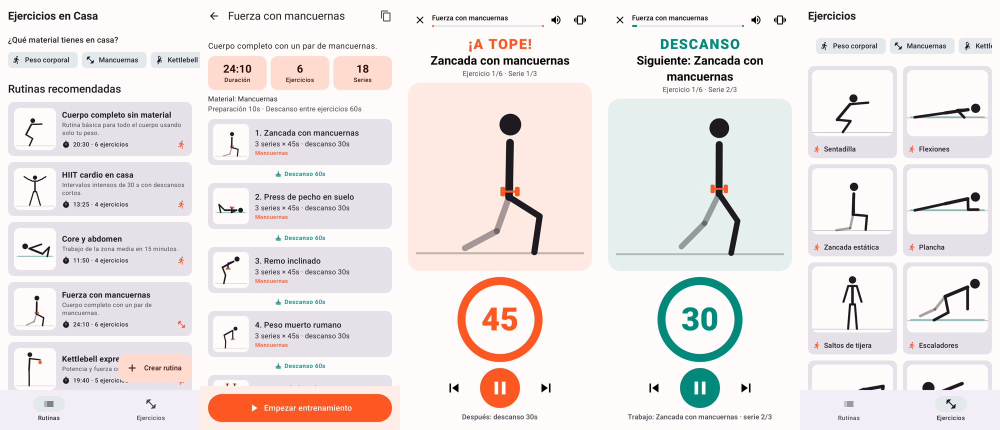
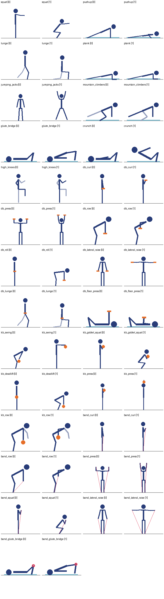

# Ejercicios en Casa 🏋️

> Este repositorio también incluye **[Mando Xbox](joystick/README.md)** (módulo
> `:joystick`), una app que usa el móvil como mando inalámbrico de la Xbox mediante
> Remote Play.

App Android para entrenar en casa con **rutinas por tiempo**: cada ejercicio se
ejecuta durante un tiempo de trabajo, con **descansos entre series** y entre
ejercicios, y un **ejemplo animado** de cómo hacer cada movimiento.



## Funciones

- **Material disponible**: marca lo que tienes en casa (peso corporal,
  mancuernas, kettlebell, bandas elásticas) y solo verás las rutinas que puedes hacer.
- **27 ejercicios animados** (figura animada dibujada en tiempo real, sin GIFs ni vídeos):
  - Peso corporal: sentadilla, flexiones, zancada, plancha, saltos de tijera,
    escaladores, puente de glúteo, crunch, rodillas al pecho.
  - Mancuernas: curl, press de hombros, remo, peso muerto rumano, elevaciones
    laterales, zancada, press en suelo.
  - Kettlebell: swing, sentadilla goblet, peso muerto, press, remo.
  - Bandas: curl, remo, press, sentadilla, elevaciones laterales, puente con mini banda.
- **7 rutinas recomendadas** (cuerpo completo, HIIT, core, mancuernas, kettlebell, bandas, mixta).
- **Crear y editar rutinas**: series, segundos de trabajo, descanso entre series,
  descanso entre ejercicios y cuenta atrás inicial. Las rutinas recomendadas se
  pueden duplicar para personalizarlas.
- **Reproductor de entrenamiento**:
  - Fases de preparación, trabajo y descanso con colores distintos.
  - Cuenta atrás circular, progreso global, pausa, saltar y retroceder.
  - Durante el descanso muestra la animación del **siguiente** ejercicio.
  - Pitidos en los 3 últimos segundos y al cambiar de fase, vibración (se pueden desactivar).
  - Mantiene la pantalla encendida mientras entrenas.
- Ficha de cada ejercicio con músculos trabajados, explicación, consejos y
  animación a velocidad normal o lenta.

## Instalar el APK

Cada push ejecuta el workflow **Android APK** (GitHub Actions), que pasa los tests
y publica `app-debug.apk` y `app-release.apk` como artefacto descargable en la
pestaña *Actions*. Copia el APK al móvil y ábrelo (hay que permitir
"instalar apps de origen desconocido"). Requiere Android 8.0 o superior.

> El APK de release está firmado con la clave de depuración para poder
> instalarlo directamente. Para publicarlo en Google Play configura tu propio keystore.

## Compilar

Requisitos: JDK 17+ y Android SDK (API 35).

```bash
./gradlew assembleDebug        # app/build/outputs/apk/debug/app-debug.apk
./gradlew testDebugUnitTest    # tests del cronómetro y del catálogo
```

O abre el proyecto en Android Studio y pulsa *Run*.

## Estructura

| Ruta | Contenido |
| --- | --- |
| `app/src/main/assets/exercises.json` | Catálogo de ejercicios, poses de animación y rutinas recomendadas |
| `data/` | Modelos y repositorio (rutinas propias y preferencias en `SharedPreferences`) |
| `workout/` | Plan de fases, máquina de estados del cronómetro, ViewModel y sonidos |
| `ui/anim/` | Cinemática de la figura y dibujo en `Canvas` |
| `ui/screens/` | Pantallas Compose: rutinas, ejercicios, ficha, editor y entrenamiento |
| `tools/` | Scripts para generar el catálogo y previsualizar las poses |

Tecnologías: Kotlin, Jetpack Compose (Material 3), Navigation Compose y kotlinx.serialization.

## Añadir o modificar ejercicios

Las animaciones se definen como fotogramas clave con ángulos de cada segmento
del cuerpo (0° = hacia abajo, 90° = hacia delante, 180° = hacia arriba) y la app
interpola entre ellos. Para cambiar el catálogo:

1. Edita `tools/generate_catalog.py` y ejecútalo: `python3 tools/generate_catalog.py`.
2. Revisa las poses con `python3 tools/preview_poses.py poses.png` (requiere Pillow).
3. Ejecuta `./gradlew testDebugUnitTest`: comprueba que las animaciones no
   atraviesan el suelo y que todas las rutinas usan ejercicios existentes.


